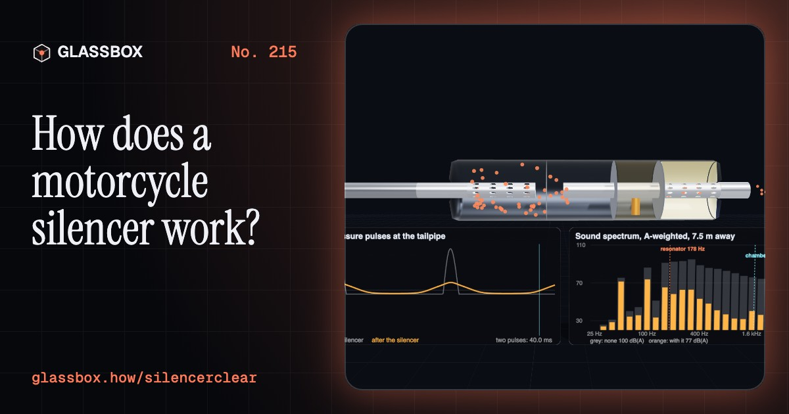
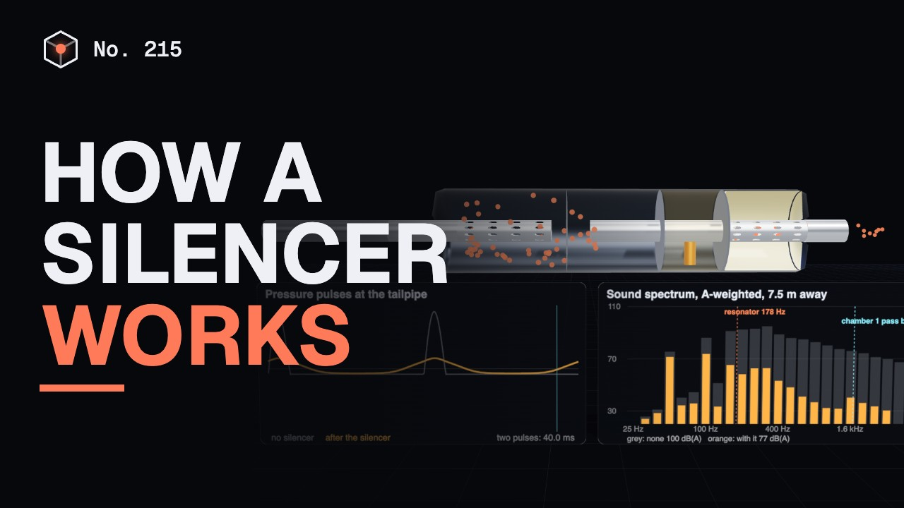
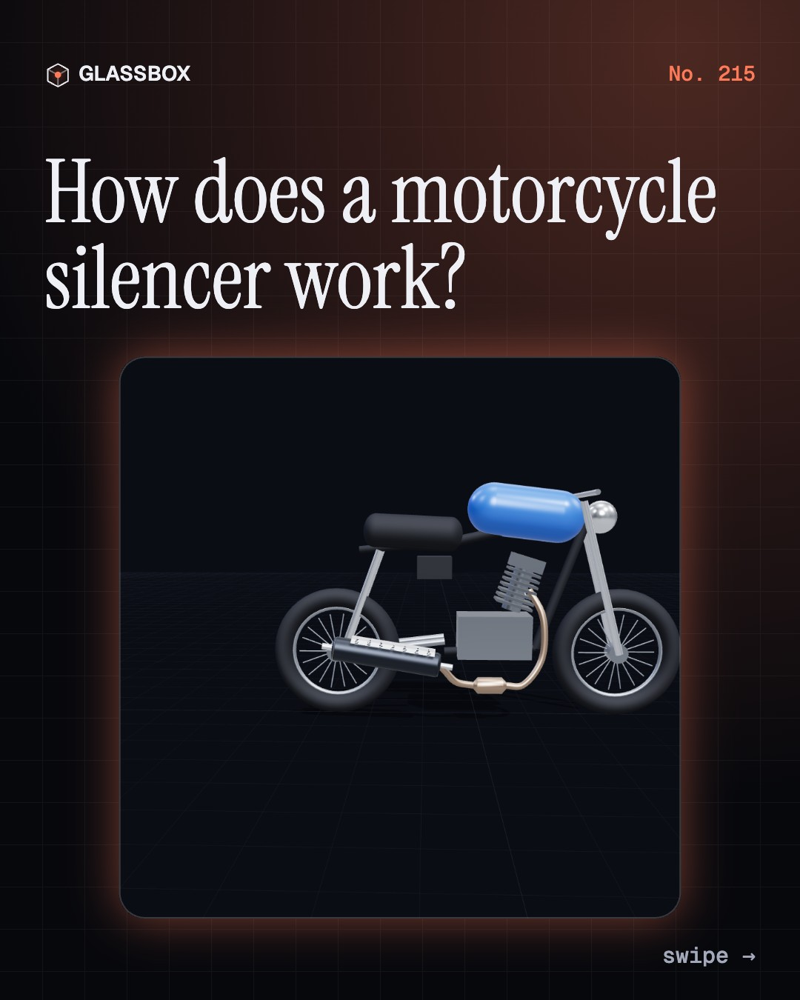
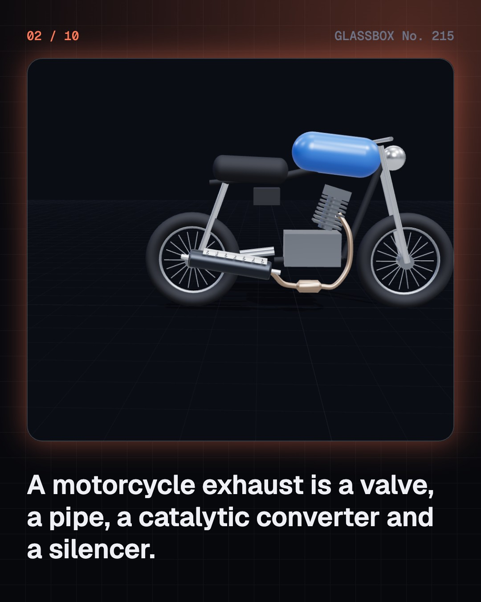
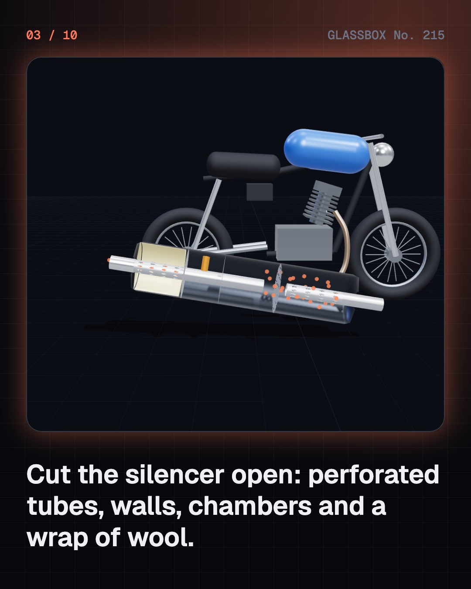
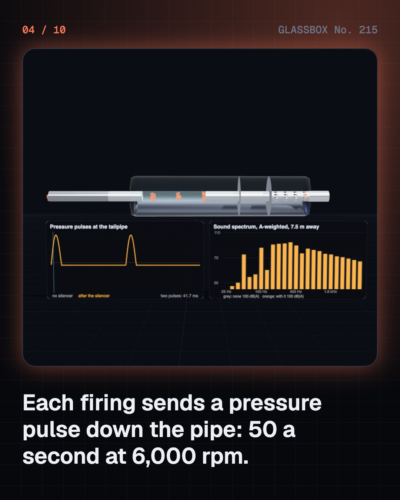

<!-- glassbox:start -->
<!-- Generated from glassbox.json by the Glassbox hub (npm run readme -- silencerclear). Edit glassbox.json, not this block. -->
<p align="center"><a href="https://glassbox.how/e/silencerclear/"></a></p>

<h1 align="center">SilencerClear</h1>

<p align="center"><b>How does a motorcycle silencer work?</b><br>Each firing blasts a pulse of hot gas down the pipe, 50 times a second at 6,000 rpm. Cut open a motorcycle silencer in 3D and see how chambers, a resonator and fibre packing turn a 100 dB bang into a 77 dB hum, while a hot honeycomb cleans the gas.</p>

<p align="center"><a href="https://glassbox.how/silencerclear/"><b>▶ Play with it</b></a> &nbsp;·&nbsp; <a href="https://glassbox.how/e/silencerclear/">Read the 60-second explainer</a> &nbsp;·&nbsp; <a href="https://glassbox.how/silencerclear/glassbox/reel.mp4">Watch the 40-second video</a></p>

<p align="center">
  <a href="https://glassbox.how/e/silencerclear/"></a>
  <a href="https://glassbox.how/e/silencerclear/"></a>
  <a href="LICENSE"></a>
  <a href="LICENSE-CONTENT.md"></a>
  <a href="#privacy"></a>
</p>

## In 60 seconds

1. **A valve, a pipe, a cleaner and a can.** Burnt gas leaves the cylinder through the exhaust valve, runs down the header pipe, passes the catalytic converter and ends in the silencer. Inside the can, perforated tubes, baffles, expansion chambers, a resonator and glass or steel wool packing make a little maze, and a heat shield keeps legs off the hot metal.
2. **Three ways to tame a pulse.** A four-stroke single fires rpm ÷ 120 times a second, sending sharp pressure pulses with a ladder of harmonics. Sudden expansion chambers reflect sound back, TL = 10 log10[1 + ¼(m − 1/m)² sin²(kL)]. A Helmholtz resonator cancels one note. Packing turns high-pitched sound into heat. In hot exhaust sound runs at about 560 m/s, so chambers are sized for the gas, not for air.
3. **Quiet costs back pressure.** The walls and holes that stop sound also resist the gas, so quieter silencers usually mean more back pressure. Engines and silencers are designed together to pass the noise and emission tests. One cylinder thumps at a low firing frequency; four cylinders hum four times faster.
4. **A hot, precise chemical reactor.** The catalytic converter is a honeycomb coated with platinum, palladium and rhodium. Hot, and with the mixture held at λ = 1 by an oxygen sensor, it turns CO, HC and NOx into CO₂, water and nitrogen. India's BS-VI rules have required this for all new vehicles since 1 April 2020.
5. **Loud silencers are illegal and harmful.** New Indian two-wheelers must pass a 7.5 m pass-by test: 75, 77 or 80 dB(A) by engine size. Removing baffles or fitting loud aftermarket silencers breaks the law, draws police fines and harms hearing: +10 dB sounds twice as loud, and NIOSH halves the safe time every 3 dB above 85 dB(A). Hot pipes burn, especially pillion riders' legs.
6. **From 1897 to BS-VI.** The Reeves brothers patented a muffler of perforated shells in 1897, Maxim's 1909 silencer gave the part its British name, catalytic converters spread from 1975, and India set vehicle noise limits from 1990 and jumped to BS-VI in 2020. Quiet electric vehicles now have to make warning sounds on purpose.

## Words worth knowing

| Term | Meaning |
|---|---|
| **Firing frequency** | Exhaust pulses per second: for a four-stroke, rpm ÷ 120 × the number of cylinders. |
| **Expansion chamber** | A sudden widening in the exhaust that reflects much of the sound back towards the engine. |
| **Helmholtz resonator** | A cavity with a neck that rings at one note; fitted beside a pipe it cancels that note. |
| **Transmission loss** | How many decibels weaker sound becomes after passing through a silencer or one of its parts. |
| **Back pressure** | The extra pressure an engine must push against to drive its exhaust out through the pipe and silencer. |
| **A-weighting** | A correction that makes a sound meter count pitches the way the human ear hears them, written dB(A). |
| **Three-way catalytic converter** | A precious-metal-coated honeycomb that cuts CO, HC and NOx at once when hot and at the right mixture. |
| **Pass-by test** | A noise test where a vehicle accelerates past microphones 7.5 m away and the loudest reading must stay under the limit. |

## A short history

**From a perforated can in 1897 to BS-VI converters and warning sounds for silent EVs.**

- **1897** · The Reeves brothers' exhaust muffler (Milton O. Reeves and Marshal T. Reeves, Columbus, Indiana, USA)
- **1909** · Maxim's silencer (Hiram Percy Maxim, Hartford, Connecticut, USA)
- **1956** · A catalytic converter for car exhaust (Eugene Houdry, Pennsylvania, USA)
- **1975** · Catalytic converters go mainstream (US carmakers, to meet EPA rules, USA)
- **1978** · Europe limits motorcycle noise (Council of the European Communities, Brussels, Belgium)
- **1986** · India counts noise as pollution (Parliament of India, New Delhi, India)
- **2000** · Today's Indian two-wheeler noise limits (Ministry of Environment and Forests, New Delhi, India)
- **2020** · BS-VI arrives (Government of India, India)

The full story, with 26 moments, charts, people and 29 sources: [glassbox.how/e/silencerclear/history](https://glassbox.how/e/silencerclear/history/). The data lives in [`history.json`](history.json).

## Video and slides

Made with the Glassbox studio from this box's storyboard (`window.glassbox.director`). Free to reuse under CC BY 4.0.

<a href="https://glassbox.how/silencerclear/glassbox/video.mp4"></a>

<p><a href="glassbox/slide-1.jpg"></a> <a href="glassbox/slide-2.jpg"></a> <a href="glassbox/slide-3.jpg"></a> <a href="glassbox/slide-4.jpg"></a></p>

| File | What | Size |
|---|---|---|
| [`glassbox/reel.mp4`](https://glassbox.how/silencerclear/glassbox/reel.mp4) | Reel / Short, with captions and soundtrack | 1080×1920 |
| [`glassbox/video.mp4`](https://glassbox.how/silencerclear/glassbox/video.mp4) | YouTube video, with captions and soundtrack | 1920×1080 |
| `glassbox/slide-1…10.jpg` | Instagram carousel | 1080×1350 |
| `glassbox/thumb.jpg` | YouTube thumbnail | 1280×720 |
| `glassbox/cover.jpg` | Share card and repo social preview | 1200×630 |
| [`glassbox/history-reel.mp4`](https://glassbox.how/silencerclear/glassbox/history-reel.mp4) | “History in 10 moments” Reel / Short | 1080×1920 |
| `glassbox/history-slide-*.jpg` | History carousel | 1080×1350 |
| `glassbox/post.json` | Post copy and schedule used by the publish kit | |

## Privacy

This box has no accounts and no ads, and it ships its own fonts and libraries. When you run it yourself it sends nothing anywhere. On glassbox.how, the site's `/bar.js` also loads Glassbox's analytics: **Google Analytics** to count visits (it asks first in the EU, UK and Switzerland, and stays off when your browser sends Global Privacy Control or Do Not Track) and **ClickTrust** to detect bots.

It remembers a few things **in your own browser only**, and never sends them anywhere:

| Browser storage key | What it holds |
|---|---|
| `silencerclear.v1` | Which chapters you have opened, your best quiz scores, and sound on or off. |

Exactly what each one sees is at [glassbox.how/privacy](https://glassbox.how/privacy/).

## Licences

- **Code:** [MIT](LICENSE). Use it, change it, ship it.
- **Explanations, text, images and videos** (`glassbox.json`, `glassbox/`): [CC BY 4.0](LICENSE-CONTENT.md). Credit “Glassbox, glassbox.how/e/silencerclear”.
- **Third-party parts** keep their own licences: [three.js](https://threejs.org) (MIT), [Geist, Instrument Serif](https://openfontlicense.org) (SIL OFL 1.1).
- The Glassbox name and logo aren't covered by either licence. See the [terms](https://glassbox.how/terms/).

Found a mistake? [Open an issue](https://github.com/bdeeps/silencerclear/issues). Corrections happen in public.
<!-- glassbox:end -->

## Run it

It's plain HTML, CSS and JavaScript. No build step and no dependencies. Run locally, it contacts no other website.

```bash
python3 -m http.server 8000
```

Three.js and the fonts ship in `vendor/` and `fonts/`, so it also works offline.

Then open http://localhost:8000.

## How it's built

| File | What |
|---|---|
| `index.html`, `css/app.css` | The page and its styles |
| `js/app.js`, `js/stage.js`, `js/ui.js`, `js/kit.js` | The shared Glassbox 3D engine: chapters, 3D stage, controls, quiz, video director |
| `js/chapters/*.js` | One file per chapter: the 3D model, controls, text, key terms, quiz and video scenes |
| `js/silencer.js` | The shared physics and models: firing frequency, sound speed in hot gas, expansion-chamber, resonator and packing transmission loss, A-weighting, the pulse spectrum, back pressure, the cut-open silencer and a generic commuter bike |
| `glassbox.json` | Title, question, explainer beats, key terms, browser storage and credits shown on glassbox.how |
| `reel` in each chapter | The storyboard the Glassbox studio records into short videos |
| `glassbox/` | The published video, slides, thumbnail and post copy |
| `fonts/`, `vendor/three/` | Self-hosted Geist and Instrument Serif (SIL OFL 1.1) and three.js (MIT) |
